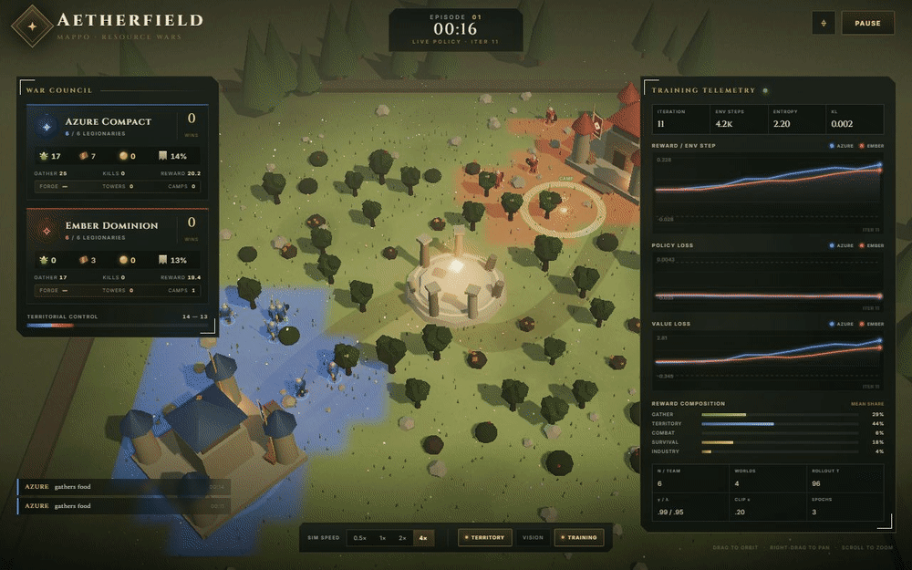
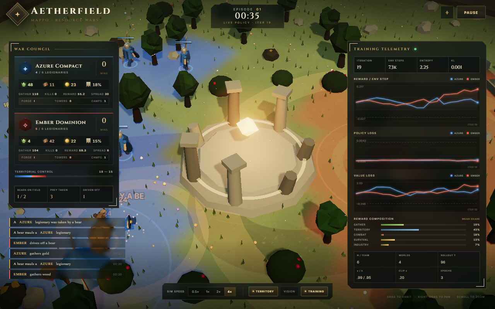
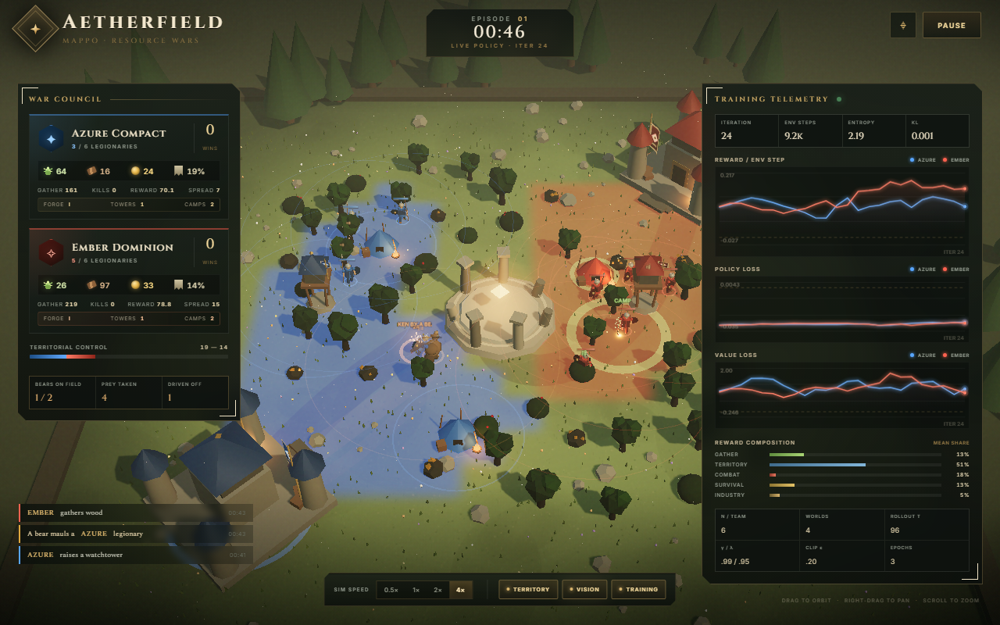
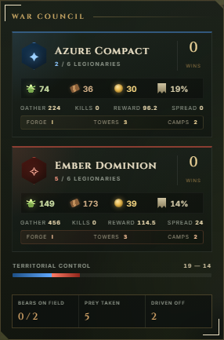
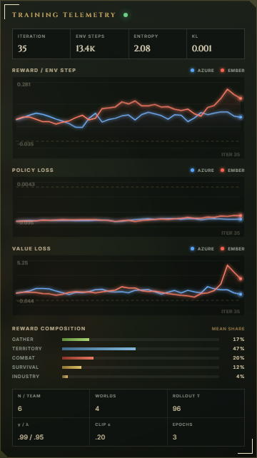
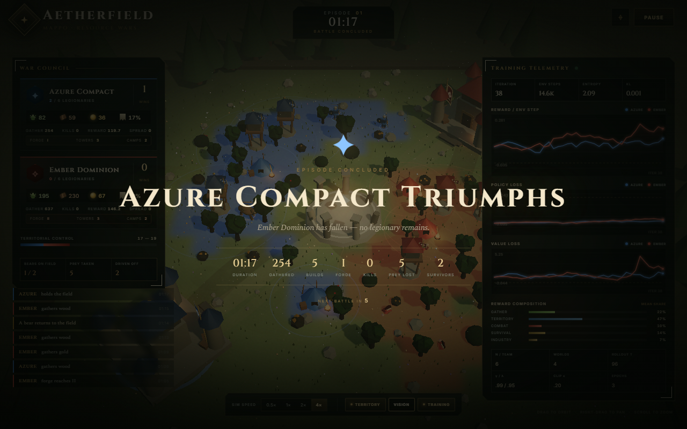

# Aetherfield — Multi-Agent PPO Resource Wars

A browser-native reinforcement-learning playground: two factions fight a war of attrition on a
36×36 field while a **MAPPO** trainer learns both factions' policies in a Web Worker, in JavaScript,
with no native dependencies. The page shows one spectator match on the main thread and streams fresh
actor weights from the worker every iteration, so what you watch is the *current* policy — not a
recording.



> The GIF is captured from the live page via a Chrome DevTools Protocol screencast at the pace it was
> recorded (43 frames over 4.93 s). The match is running at 4× speed in this clip.
> A lossless version is available as [`docs/assets/demo.mp4`](docs/assets/demo.mp4) — GitHub does not
> inline-play video in markdown, so it is a link.

---

## What is running

| Piece | Where | Job |
| --- | --- | --- |
| `BattleEnv` | main thread | one spectator match, rendered by Three.js |
| `MAPPOTrainer` | Web Worker | 4 parallel worlds, synchronous rollout → GAE → PPO |
| Actor weights | worker → main | transferred as `ArrayBuffer` each iteration |
| HUD | main thread | faction cards, live training metrics, reward decomposition, charts |
| Boot gate | main thread | the overlay clears after `8` training iterations land |

Both factions are trained independently: each has its own actor (policy) and critic (value), and the
critic sees the whole battlefield state while actors see only what a single legionary can perceive.

---

## The battlefield

- **Field**: 36×36 units on an 18×18 grid, `dt = 0.1 s` per step.
- **Armies**: 2 teams × 6 legionaries — Azure Compact (✦) and Ember Dominion (✧).
- **Vision**: 7.0 units. An agent only reports agents, nodes and structures inside that radius.
- **Life support**: HP 100, energy 100, energy drains 1.35/s. Eating costs 3 energy and restores 33;
  below 34 energy the agent starves and loses 4 HP/s. Idle agents regen 0.3 HP/s.
- **Combat**: 16 base damage, 0.75 s cooldown, attack range 1.55.
- **Field hazard**: two bears roam the mid-field as scripted neutral NPCs. They prey on whichever
  legionary they can see — Azure or Ember alike — and a warband can drive them off. See below.
- **Territory**: structures project influence continuously; the HUD percentages are the share of the
  grid held by each faction. Capturing cells and holding them are both rewarded.
- **Victory**: a match ends when one faction has no living legionaries. Both wiped = *Mutual Ruin*.
  Winner gets `+10`, loser `-10`; the overlay counts down and the next episode starts automatically.

### Resources

| Resource | Node capacity | Harvest rate | Regrow | Respawn fraction | Used for |
| --- | --- | --- | --- | --- | --- |
| Food | 90 | 9/s | 18 s | 0.85 | eating, field camps |
| Wood | 140 | 8/s | 30 s | 0.85 | watchtowers, field camps |
| Gold | 70 | 6/s | 48 s | 0.70 | the forge |

### Structures (wood; max 5 per team)

| Structure | Cost | Max | Effect |
| --- | --- | --- | --- |
| Watchtower | 18 wood | 3 | fires at intruders: 8 damage every 1.8 s within 5.6 units; influence 4.2, +1.35/s |
| Field Camp | 14 wood | 2 | heals 2.4/s and makes 0.5 food/s within 3.4 units; influence 2.4, +0.8/s |

Builds are also gated by spacing (3.2 / 2.8 units from existing structures) — that constraint is
exposed as an action mask, not learned from scratch.

### The forge

Gold melts into a **team-wide** equipment tier. Whenever the stockpile covers the next tier's cost it
upgrades automatically, and every living legionary gains health and damage:

| Tier | Cost | Bonus HP | Bonus damage |
| --- | --- | --- | --- |
| Militia | — | 0 | 0 |
| Bronze | 25 | +12 | +3 |
| Iron | 50 | +26 | +6 |
| Steel | 80 | +42 | +9 |
| Mithril | 120 | +60 | +12 |

So gold is a long-term military investment, and the policy has to decide between feeding soldiers now
and arming them later.

### Field hazard — bears

Bears are the one thing on the field nobody trains. They are scripted NPCs that roam the band around
the central ruin, stalk the nearest legionary inside the same 7-unit vision the agents use, and maul
it at close range. They are attackable, so hunting one is a real decision: it costs time and health
that could be spent on the enemy.

| Parameter | Value |
| --- | --- |
| Bears on the field | 2 (`PREDATORS`; one bear is a one-line change) |
| Health | 300, regenerating 2.0/s after 4 s without damage |
| Speed | 1.85 units/s — slower than a fleeing legionary (2.55) |
| Maul | 24 damage every 1.2 s at 1.9 units |
| Roam band | 4.5–13.5 units around the ruin, new target every 11 s |
| Keep clearance | 11.5 units — bears never enter a fortress footprint or a spawn stack |
| Driven off | reaching 0 HP removes the bear for 42 s, then it returns at full health |

Bringing a bear to zero *drives it off* rather than killing it, so the hazard stays live and cannot be
farmed for reward. Legionaries swing at bears through the same attack action, and watchtowers treat a
bear in range as an intruder. A bear can wipe a faction, so matches can end by predation; predation is
scored as a death, not as a faction kill.

---

## Action space (13 actions, masked)

| Index | Action |
| --- | --- |
| 0 | Idle |
| 1–8 | Move in one of eight compass directions |
| 9 | Harvest the nearest eligible node |
| 10 | Attack the nearest target in range |
| 11 | Build a Watchtower |
| 12 | Build a Field Camp |

Illegal actions are masked out of the softmax, so an agent cannot waste its policy on a build it cannot
afford or an attack with no target in range. The attack mask counts a bear as a threat: it is legal
whenever an enemy legionary *or* a bear is inside vision, and whichever is nearer takes the swing.

### Reward shaping

Per-step weights (`src/sim/config.js`), tuned so a minute of dedicated gathering is worth roughly a
decisive mid-field fight plus the territory it secures:

| Term | Weight | Term | Weight |
| --- | --- | --- | --- |
| Food gathered | +0.09 | Damage dealt | +0.08 |
| Wood gathered | +0.055 | Kill | +1.8 |
| Gold gathered | +0.20 | Death | −1.8 |
| Territory capture | +0.22 | Starving | +0.28 |
| Territory hold | +0.012 | Starve death | −1.2 |
| Survival | +0.06 | Build structure | +0.9 |
| Camp food | +0.05 | Forge upgrade | +1.6 |
| Bear damage dealt | +0.022 | Bear driven off | +1.4 |
| Victory | +10 | Defeat | −10 |

Predation reuses the death weight: a legionary taken by a bear is a death with no killer credited to
either faction, and bear rewards land in the same combat bucket as faction kills.

---

## Observations and MAPPO

- **Per-agent observation**: `OBS_DIM = 117` — self state (6), visible resource nodes (3 × 3 × 5),
  allies (4 × 4), enemies (5 × 5), bears (2 × 4), territory (3), base (3), team economy (5), own agent id (6).
- **Global state for the critic**: `STATE_DIM = 105` — both rosters (72), stockpiles, lifetime gathered,
  territory shares, alive counts, formation hull area (2), remaining resources, living nodes, forge
  tiers + structure counts, bears (2 × 4), time phase.
- **Policy**: MLP with a 64-unit hidden layer, trained by hand-written forward/backward passes with
  Adam. Softmax is masked; the PPO surrogate is clipped, and the value loss is clipped to the same
  window.
- **Critic**: MLP with a 96-unit hidden layer on the global state (MAPPO's "shared critic" pattern).
- **Advantage estimation**: GAE(λ), with terminal flags masked out so episode boundaries do not leak
  bootstrapped values between matches. Advantages are normalized over living agents only.

### Formation — does a faction cluster or go solo?

The critic gets one extra pair of features: the area of the **convex hull** of each squad's *living*
legionary positions, expressed as a fraction of the field (1296 square units). One number per faction
summarises the shape of the whole squad:

| Squad shape | Hull area | State value |
| --- | --- | --- |
| Huddled on its spawn ring | ~11–15 units² | ~0.01 |
| Tight knot, a couple of units apart | ~2 units² | ~0.001 |
| Strung along a line (collinear) | 0 | 0 |
| Scattered into solo bands across the mid-field | ~700 units² | ~0.55 |
| Fewer than three survivors | 0 | 0 |

Dead legionaries are excluded, so a faction that loses its scattered members reads as clustered again.
Degenerate shapes are handled rather than faked: the hull is Andrew's monotone chain plus a shoelace
sum, which encloses nothing for one or two survivors and for collinear squads.

It is a **state** feature, not an observation — agents never see the hull, only the critic does, so it
is context for the value function rather than a reward. The faction panel prints the same area as
`SPREAD` in square field units, so you can watch each warband drift between clustering and dispersion
as training progresses.

| Hyperparameter | Value | Meaning |
| --- | --- | --- |
| `worlds` | 4 | parallel environments per iteration |
| `rollout` | 96 | steps collected per world → 4608 transitions per iteration |
| `gamma` | 0.99 | discount |
| `lambda` | 0.95 | GAE trace |
| `clip` | 0.2 | PPO ratio clip |
| `epochs` | 3 | passes over the buffer (≈54 gradient steps) |
| `minibatch` | 256 | 18 minibatches per epoch |
| `actorLR` | 3e-4 | actor Adam learning rate |
| `criticLR` | 7e-4 | critic Adam learning rate |
| `entropy` | 0.012 | entropy bonus |
| `valueClip` | 0.2 | clipped value loss window |
| `maxGradNorm` | 0.5 | gradient-norm clamp |
| `hidden` / `criticHidden` | 64 / 96 | MLP widths |

The worker schedules the next iteration 12 ms after the previous one and posts both factions' actor
weights with transferable buffers, so the visible match keeps playing the newest policy while training
continues.

---

## HUD tour

Low camera angle over the mid-field — a bear is mauling Azure legionaries on the left (amber `-24`
labels), and a second bear prowls past an Ember camp on the right:



Vision overlay — the radius an agent actually perceives (amber rings are the bears'):



Faction panel — stockpiles, territory share, kills, forge tier, structures, formation spread (the
convex-hull area of the living squad), per-legionary roster, and the field-hazard strip for bears on
the field, legionaries taken, and bears driven off:



Training panel — iteration, steps, entropy, KL, reward/policy/value charts and the reward
decomposition bars:



End of match (Ember Dominion wiped out):



---

## Running it

```bash
npm install
npm run dev        # http://127.0.0.1:5173
npm test           # 25 node:test assertions on economy, formation, predators, masks, PPO
```

On Windows, `START.bat` installs dependencies on first run and launches the server.

Controls: `0.5× / 1× / 2× / 4×` match speed, `PAUSE`, `⌖` recenter the camera, `TERRITORY` and
`VISION` overlays, and `TRAINING` to pause or resume the worker (the match keeps running either way).
Drag to orbit, scroll to zoom.

Requires Node 18+ and a modern browser; module workers are loaded with `type: "module"`.

---

## Regenerating the media

All images and clips in this README were captured with Playwright, then encoded with ffmpeg +
ImageMagick.

```bash
npm run dev              # must be running: capture drives window.__aether, which only exists in dev builds
npm run capture          # docs/assets/raw/  clip frames (+ timing manifest) + HUD stills
npm run media            # docs/assets/hero.gif, docs/assets/demo.mp4, copied stills
```

The hero clip uses `Page.startScreencast` rather than `page.screenshot()` — screenshots cost ~1.6 s per
frame and would produce a fake fast-forward clip. The clip's real arrival times are written to
`docs/assets/raw/clip/manifest.json`, and the encoder plays back at that measured rate, so the GIF is
honest real time.

Tunables (environment variables): `SHOT_URL`, `SHOT_DIR`, `CLIP_SECONDS`, `CLIP_FPS`, `GIF_WIDTH`,
`GIF_HEIGHT`. The GIF is generated with `palettegen=max_colors=128` and `paletteuse=dither=sierra2_4a`
to keep the dark scene and the bloom readable; `docs/assets/raw/` is git-ignored.

---

## Project layout

```
LICENSE               MIT (see LICENSE)
index.html            HUD markup (arena canvas, faction council, telemetry, overlays)
src/main.js           spectator match, boot gate, victory flow, worker wiring, speed/toggle controls
src/render/arena.js   Three.js scene, OrbitControls, territory and vision overlays, legionary + bear models
src/render/effects.js hit sparks, bloom, muzzle effects
src/render/charts.js  reward / policy / value line charts
src/sim/config.js     every environment and MAPPO constant (the tables above)
src/sim/env.js        BattleEnv: movement, harvesting, combat, bears, structures, territory, formation hull, rewards, masks
src/sim/policy.js     Actor/Critic MLPs, manual backprop, Adam, masked softmax, clipped PPO losses
src/sim/mappo.js      rollout, GAE with terminal masks, alive-masked advantage norm, PPO epochs
src/sim/worker.js     4 worlds, per-iteration weight transfer, 12 ms scheduling
src/sim/rng.js        deterministic seeded RNG (same seed → same battlefield)
scripts/capture.mjs   Playwright + CDP screencast capture
scripts/media.mjs     GIF / MP4 / still encoding pipeline
tests/                economy, formation, predator, and PPO invariants (node --test)
docs/assets/          shipped README media
```

---

## Notes

- Training is pure JavaScript with hand-written backprop — the point is legibility of the MAPPO loop,
  not throughput. Iterations are synchronous inside the worker; the main thread never blocks.
- There is no checkpoint save/load yet; refreshing the page restarts training from scratch.

---

## License

Released under the **MIT License** — see [`LICENSE`](LICENSE). The README media in `docs/assets/`
(captured from this project's own render) is covered by the same license.
